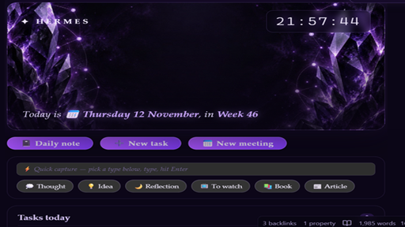

# Hermes Crystal

Amethyst crystal-glass theme for Obsidian. Deep violet nebula background, glassmorphism panes, serif gradient headings, and glowing purple accents.



## Features

- **Crystal nebula background** — fully embedded in the CSS (no external files), with a slow "breathing" glow animation (disabled automatically when your OS requests reduced motion)
- **Glassmorphism workspace** — frosted panes for editor, sidebars, tabs, modals, menus, and status bar
- **Serif gradient headings** — Palatino-family headings with a light-to-violet gradient and soft glow (H1 in reading and live preview)
- **Crystal checkboxes** — rounded, glowing diamond-style task checkboxes
- **Styled callouts, tables, tags, code, embeds, blockquotes** with rounded crystal styling
- **Mobile aware** — dedicated `is-mobile` background variant for iPhone portrait
- **Plugin support** — tuned styles for Kanban, Dataview, Tasks, and obsidian-git

## Companion plugin: Agentic Dashboard

The dashboard this theme was designed around is now a standalone community plugin: [Agentic Dashboard](https://github.com/faizulahasun-cloud/agentic-dashboard) — a crystal-glass dashboard with video hero, quick capture, today's tasks, calendar, stats, meetings, recents and inbox, plus built-in agent actions (Obsidian CLI + `obsidian://` links). It works with any theme and has no plugin dependencies.

If you use the original custom dashboard note instead, the theme styles it via the `hermes-dashboard` cssclass:

```yaml
---
cssclasses: [hermes-dashboard]
---
```

## Install

1. Open **Settings → Appearance → Themes → Manage**
2. Click **Browse** and search for **Hermes Crystal**
3. Click **Install**, then **Use**

Manual install: copy `theme.css` and `manifest.json` into `.obsidian/themes/Hermes Crystal/` in your vault.

## Recommended accent

Works out of the box with the default accent. For a perfect match set the accent color to `#b18cff`.

## License

[MIT](./LICENSE)
